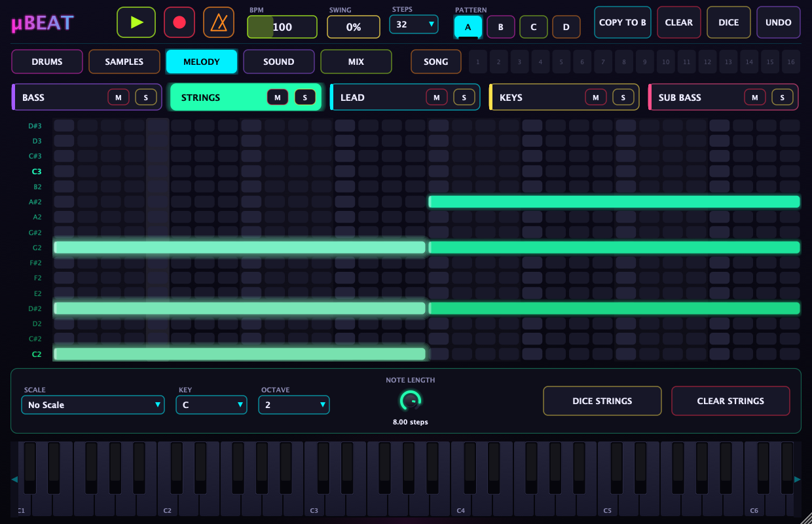

# μBeat

A groovebox for kids, built with [JUCE](https://juce.com). Drums, your own mic recordings and five synth parts play from one 32-step sequencer. It builds as a standalone app, an AU and a VST3.



- **Drums:** eight synthesised 808-style drums.
- **Samples:** four slots you record from the mic or fill by dropping in a sound file.
- **Synth tracks:** Bass, Strings, Lead, Keys and Sub Bass. Each has its own sound, LFOs, arpeggiator and note grid. Notes can last several steps.
- **Sequencer:** four patterns, a song chain, swing, record, mute and solo, and a metronome.
- **Dice:** writes a random beat, plus a part for each track in its own style, so the parts fit together.

## Build

You need macOS, CMake (`brew install cmake`) and the Xcode Command Line Tools. The first configure downloads JUCE.

```sh
cmake -B build -G "Unix Makefiles" -DCMAKE_BUILD_TYPE=Release
cmake --build build -j8
ctest --test-dir build --output-on-failure
open build/uBeat_artefacts/Release/Standalone/uBeat.app
```

Press space to play. To use it in Logic, see [Using it in Logic](docs/user-guide.md#using-it-in-logic).

Files and build targets use the ASCII name `uBeat`. It has only been built and tested on macOS.

## Docs

- [User guide](docs/user-guide.md): every feature, tab by tab.
- [Developer guide](docs/developer-guide.md): how the code fits together and how to add to it.
- [Changelog](CHANGELOG.md)
- [Contributing](CONTRIBUTING.md)

## Licence

[AGPLv3](LICENSE). μBeat uses JUCE under JUCE's AGPLv3 licence, so anything you build from this code and distribute must also be released under the AGPLv3, unless you have a commercial JUCE licence.
