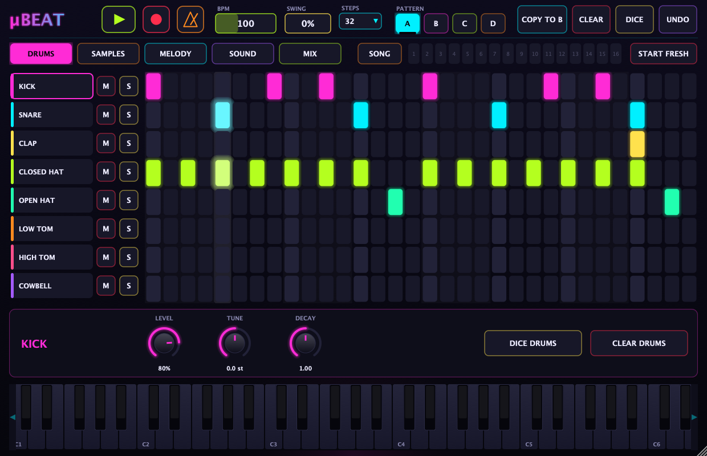
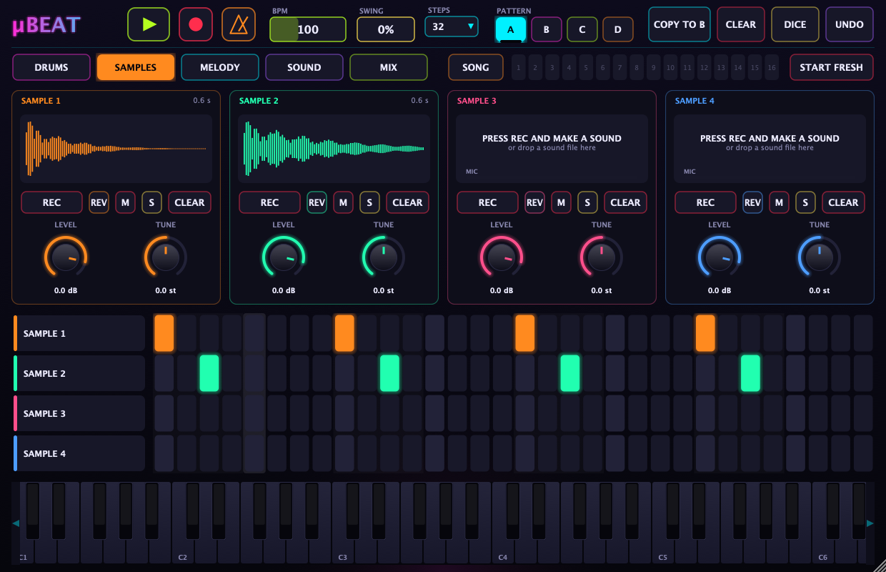
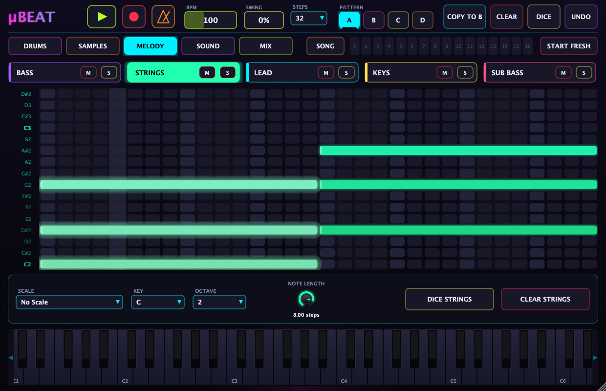
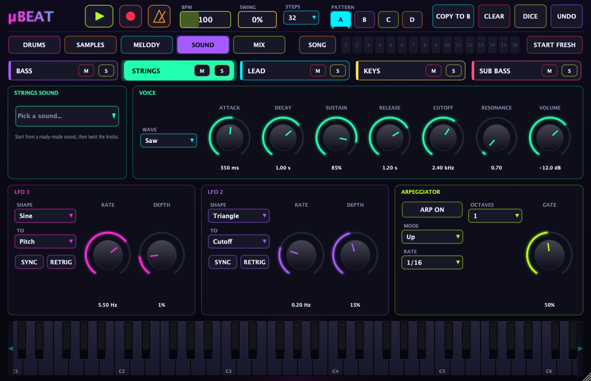
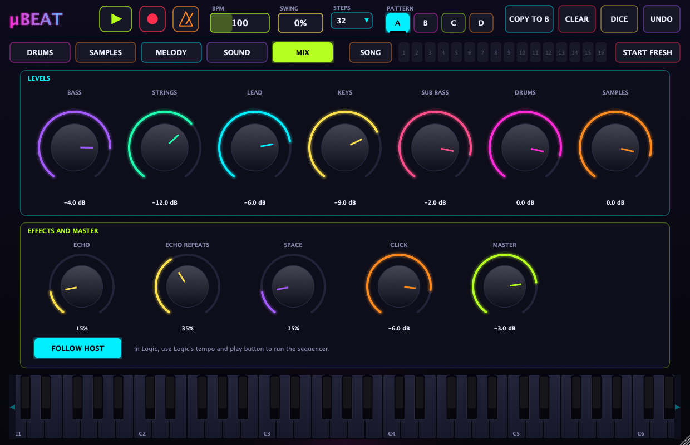

# User guide

μBeat is a groovebox: drums, your own recorded sounds and five synth parts, all playing from one 32-step sequencer. It runs as an app on its own, or as an instrument inside Logic.

## Getting started

1. Open the μBeat app (see [Installing](#installing)).
2. Press the space bar. A demo beat with bass, strings and a tune plays.
3. Press **DICE** in the top bar for a new random beat and parts, as many times as you like.
4. Press **UNDO** to go back to the last one.

If there is no sound, click **Options** at the top of the window and pick your speakers.

## Installing

Download the zips from [Releases](https://github.com/jamiemarkwhite/synth/releases), or build them yourself (see the [README](../README.md#build)). Each zip holds one format:

| Zip | What it is | Where it goes |
| --- | --- | --- |
| `uBeat-<version>-macOS-App.zip` | The app on its own | `/Applications` |
| `uBeat-<version>-macOS-AU.zip` | Instrument for Logic and GarageBand | `~/Library/Audio/Plug-Ins/Components` |
| `uBeat-<version>-macOS-VST3.zip` | Instrument for other music apps | `~/Library/Audio/Plug-Ins/VST3` |

`~/Library` is hidden in Finder. To get there, press Cmd+Shift+G in Finder and paste the folder path. If the `Components` or `VST3` folder doesn't exist yet, create it.

### Getting past macOS security

macOS adds a "downloaded from the internet" flag (the quarantine flag) to everything you download. Apps and plugins carrying that flag only open if Apple has notarised them. μBeat's builds aren't notarised, because that needs a paid Apple developer account. So the first time you open the app, macOS blocks it with a message saying it can't be opened, that Apple could not verify it, or that it is damaged. The files aren't damaged: the block comes from the flag. Only clear the flag on files you downloaded from the [Releases page](https://github.com/jamiemarkwhite/synth/releases).

There are two ways past it.

**Option 1: System Settings (the app only)**

1. Double-click `uBeat.app`. macOS blocks it. Click **Done** or **OK**, not **Move to Bin** (or **Move to Trash**).
2. Open System Settings > Privacy & Security and scroll down to Security.
3. Click **Open Anyway** next to the message about uBeat, then confirm with your password.

After that, the app opens normally. If macOS says the app is damaged, there is no Open Anyway button: use option 2.

**Option 2: Terminal (the app and the plugins)**

1. Copy the files into place (see the table above).
2. Open Terminal (Applications > Utilities).
3. Paste these lines and press Return. Each line clears the flag from one format; a line for a format you didn't install prints "No such file" and does nothing else.

   ```sh
   xattr -dr com.apple.quarantine /Applications/uBeat.app
   xattr -dr com.apple.quarantine ~/Library/Audio/Plug-Ins/Components/uBeat.component
   xattr -dr com.apple.quarantine ~/Library/Audio/Plug-Ins/VST3/uBeat.vst3
   ```

4. Open the app, or restart your music app so it picks up the plugins.

### If Logic doesn't show μBeat

If Logic checked the AU before you cleared the flag, it remembers the failure. Open Logic Pro > Settings > Plug-in Manager, find μBeat, select it and click **Reset & Rescan Selection**.

To check the plugin yourself, run `auval -v aumu Ubt1 Ubea` in Terminal. It ends with `AU VALIDATION SUCCEEDED` when the plugin is installed correctly.

## The top bar

These controls are always on screen, whichever tab is open.

| Control | What it does |
| --- | --- |
| Play | Starts and stops playback. The space bar does the same. |
| Record | While playing, pads you tap and keys you play are written into the pattern on the nearest step. |
| Metronome | Clicks on every beat while playing, with a higher click on the first beat of each bar. Its volume is the CLICK knob on the Mix tab. |
| BPM | Tempo, 40 to 200 beats per minute. |
| Swing | Pushes every second step late for a bouncier feel. |
| Steps | Pattern length: 8, 16, 24 or 32 steps. |
| A B C D | The four patterns. Click one to edit and play it. A dot on a pattern you're not on means it has something in it. |
| COPY TO | Copies the current pattern into the next one and switches to it, so you can make a variation. |
| CLEAR | Empties the current pattern: drums, samples and every synth part. |
| DICE | Makes a random beat and a part for every synth track. |
| START FRESH | Empties everything: all four patterns, the song and every sample slot. Sounds, mutes, solos and settings go back to how they start, and playback stops. It asks first, and can't be undone. |
| UNDO | Undoes the last Dice, Clear or Copy. Pressing it again puts the change back. Single cell edits and clearing a sample slot cannot be undone. |

## Drums tab



Eight drums, each synthesised rather than recorded: kick, snare, clap, closed hat, open hat, low tom, high tom and cowbell.

- Click a cell in the grid to add a hit, click it again to remove it. Drag across cells to paint several at once.
- Tap a drum's name to hear it and select it. The strip at the bottom then shows its LEVEL, TUNE (up or down 12 semitones) and DECAY (how long it rings).
- **M** mutes a drum in the pattern. **S** solos it (see [Solo](#solo)).
- The closed hat cuts off a ringing open hat, like on a real drum machine.
- DICE DRUMS and CLEAR DRUMS only change the drums.

## Samples tab



Four slots for sounds you record yourself or load from a file. Each slot has its own row in the grid at the bottom, which works like the drum grid.

To record a sound:

1. Press **REC** on a slot. The MIC bar shows how loud the microphone is.
2. Make your sound: a word, a clap, a song.
3. Press **STOP**. Recording also stops by itself after 5 seconds.

The quiet parts at the start and end are cut off and the volume is evened out. If nothing loud enough came in, the slot says "Too quiet!" and stays as it was. macOS asks for permission to use the microphone the first time.

You can also drop a sound file (WAV, AIFF, MP3, FLAC, OGG, M4A or CAF) onto a slot. Up to 10 seconds of it is loaded.

Each slot has:

- **REV**: plays the sound backwards.
- **M**: mutes it in the pattern.
- **S**: solos it (see [Solo](#solo)).
- **CLEAR**: empties the slot. This cannot be undone.
- **LEVEL** and **TUNE** (up or down 24 semitones; up makes voices squeaky, down makes them deep).

Click the waveform to hear the sound. Recorded and loaded sounds are saved with the session.

## Melody tab



There are five synth tracks, all playing at the same time:

| Track | Starting sound | Starting octave |
| --- | --- | --- |
| Bass | Fat Bass | 1 |
| Strings | Strings | 2 |
| Lead | Chip Lead | 3 |
| Keys | Tremolo Keys | 3 |
| Sub Bass | Sub Bass | 0 |

Click a track in the bar at the top to edit it. The on-screen keyboard and the computer keyboard then play that track too. **M** on a track mutes its pattern; you can still play it live. **S** solos it (see [Solo](#solo)).

Each track has its own grid. Rows are notes, low at the bottom, with the note names on the left. Columns are steps.

- **Add a note:** click an empty cell.
- **Long note:** click an empty cell and drag right. The note lasts as many steps as it covers.
- **Change a note's length:** drag it left or right.
- **Remove a note:** click it without dragging.

A note on a single cell lasts for the track's **NOTE LENGTH**, which goes from a tenth of a step up to 16 steps. Long notes always last exactly as long as they are drawn, and stop at the end of the pattern.

The controls at the bottom:

- **SCALE**: with **No Scale** (the starting setting) each row is the next semitone, so every note is available. Pick a scale (Major, Minor, Major Pentatonic, Minor Pentatonic, Blues or Dorian) and the rows become only that scale's notes, so anything you draw sounds right. All tracks share the scale.
- **KEY**: the note the scale starts on. Also shared by all tracks.
- **OCTAVE**: how high or low this track plays, from -1 (very deep) to 7 (very high). Octaves are numbered the way Logic numbers them, with middle C as C3. At high octaves the top rows can go past the highest note there is; those rows have no name and stay silent.
- **DICE** and **CLEAR** change only this track.

Dice writes each track in its own style: chords held for 8 steps on Strings, a bass line that follows the chords, the chord's root held underneath on Sub Bass, a tune on Lead, and short off-beat chords on Keys. With No Scale, Dice uses the notes of the minor pentatonic scale so the parts fit together.

## Sound tab



Shows the sound of the track selected in the bar at the top.

- **Preset menu:** pick a ready-made sound, then change it with the knobs. The presets are Init, Fat Bass, Pluck, Dreamy Pad, Wobble Bass, Chip Lead, Arp Sparkle, Laser, Strings, Sub Bass and Tremolo Keys.
- **Voice:** wave shape (sine, saw or square), ATTACK, DECAY, SUSTAIN and RELEASE (how the sound starts and fades), CUTOFF and RESONANCE (how bright and how sharp it sounds), and VOLUME.
- **LFO 1 and LFO 2:** wobble the pitch, the cutoff or the volume. Pick a SHAPE and what it goes TO, then turn up DEPTH. **SYNC** locks the speed to the tempo and swaps the rate knob for note lengths from 4 bars down to 1/16. **RETRIG** restarts the wobble on every new note.
- **Arpeggiator:** when **ARP ON** is lit, holding a chord plays its notes one at a time. This works for notes in the track's pattern as well as notes you play. MODE is up, down, up and down, or random. RATE is how fast (1/4 to 1/32), OCTAVES spreads it over 1 to 3 octaves, and GATE is how long each note lasts.

## Mix tab



- **Levels:** a volume knob for each synth track, plus DRUMS and SAMPLES.
- **ECHO** and **ECHO REPEATS:** a dotted-eighth echo that bounces between left and right, on the synth tracks.
- **SPACE:** reverb on everything except the metronome.
- **CLICK:** metronome volume.
- **MASTER:** overall volume. A limiter on the output stops it getting louder than the speakers can handle.
- **FOLLOW HOST:** in Logic, lets Logic's tempo and play button run the sequencer. It makes no difference in the standalone app.

## Solo

Every drum, sample slot and synth track has an **S** button. While any S is lit, only the parts with S lit play from the pattern; everything else goes quiet. Turn them all off to hear everything again. You can solo several parts at once, for example the kick and the bass.

- **M** wins over **S**: a part with both lit stays quiet.
- Solo only affects the pattern. Pads, the keyboard and Logic's MIDI still play.
- The metronome is not affected.

## Songs

The 16 slots next to **SONG** make a song out of patterns.

1. Click a slot to pick A, B, C or D. Clicking again moves to the next pattern, then empty. Right-click empties it.
2. Turn **SONG** on. Playback goes through the filled slots from left to right, then starts again.

## Computer keyboard

- **Space:** play and stop.
- **The A, S, D, F row and the W, E, T row above it:** play the selected synth track like piano keys. A plays C2.

## Saving

The standalone app saves everything when you quit and brings it back next time: patterns, sounds, settings and recorded samples. In Logic, everything is saved with the Logic project.

## Using it in Logic

Logic loads the AU version. Install it (see [Installing](#installing)), restart Logic, and check it in Logic's Plug-in Manager if it doesn't show up. From Terminal, `auval -v aumu Ubt1 Ubea` runs the same check.

It appears under Instruments > AU Instruments > uBeat > μBeat.

- With **FOLLOW HOST** on, Logic's tempo and play button run the sequencer, lined up with Logic's bars.
- MIDI on channel 10 plays the drums using General MIDI note numbers (kick 36, snare 38, clap 39, closed hat 42, low tom 45, open hat 46, high tom 50, cowbell 56). Notes 60 to 63 on channel 10 play sample slots 1 to 4.
- MIDI on any other channel plays the synth track selected in the plugin.
